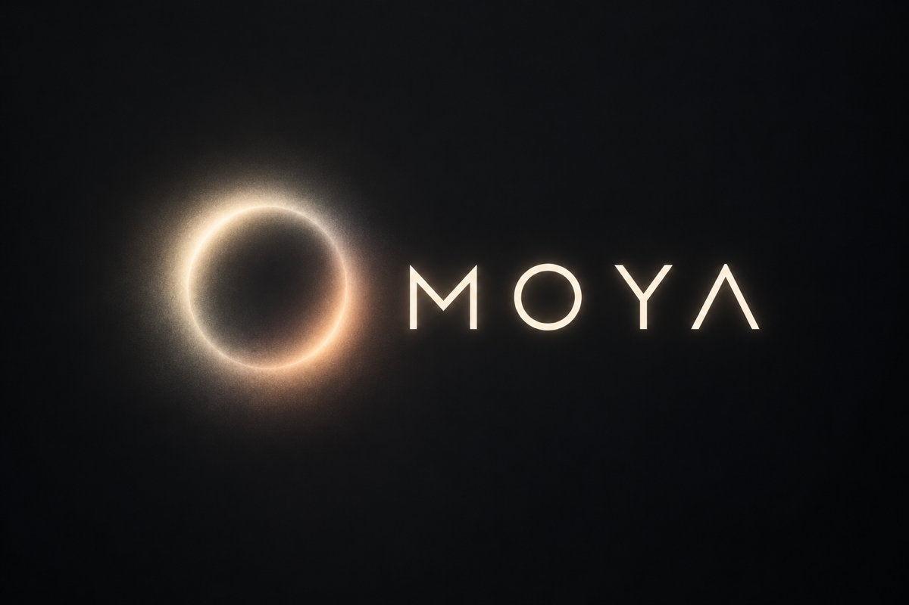

# Moya

GPU-powered glow and light effects, with a standalone macOS app and a Photoshop round trip.

- Glow/bloom, glare and spectrum, rays, chromatic aberration, and tone mapping.
- Paintable masks with image-based builders, refinement, and undo/redo.
- Presets with live hover previews and import/export.
- Photoshop round trip with editable effect layers and saved settings.
- 8/16/32-bit images; PNG, TIFF, EXR, and flattened PSD/PSB input (JPEG too). Export PNG, TIFF, or EXR.

## Install

**Requirements:** macOS 13 or later on Apple Silicon. The optional plugin requires Adobe Photoshop 2024 or later and Creative Cloud for `.ccx` installation.

1. Download **Moya-&lt;version&gt;-macos-arm64.zip** from the [latest release](https://github.com/reiserFSs/Moya/releases/latest).
2. Unzip it and **quit Photoshop** before installing the plugin.
3. Double-click **Install Moya.command**. It copies the app to `/Applications` (or `~/Applications` if needed), clears quarantine on that copied app, and opens **Moya Photoshop Plugin.ccx** for installation. Approve installation in Creative Cloud.
4. Open **Moya** from Applications. For the plugin, start Photoshop and open **Plugins › Moya**.

**First launch / Gatekeeper:** the app is ad-hoc signed, not notarized. If macOS blocks the installer or app, right-click it and choose **Open**; on newer macOS versions, allow it in **System Settings › Privacy & Security** if prompted. Only override a warning for a release you trust. If Photoshop was running during installation, quit it and rerun the installer.

For manual installation, copy **Moya.app** to `/Applications` or `~/Applications`, then double-click **Moya Photoshop Plugin.ccx** and approve installation in Creative Cloud. The plugin discovers either app location; its **Settings** panel also accepts an explicit app path.

## Using Moya

1. **Open or drop an image or project.** Use **Cmd+O**, or drop a supported image or `.moya` file anywhere in the window.
2. **Build your layer stack.** The **Layers** panel sits to the right of the preview. Add, duplicate, rename (double-click), reorder (drag a row, or Up/Down), hide, solo or delete effect layers; each has its own settings and mask. Choose a layer's input (original image or the composite below), blend mode and opacity under the list. Collapse the panel with **>>** to a narrow strip of layer swatches and widen it by dragging its edge; both are remembered. Select a layer and its settings appear in the left panels. Start with glow, then enable Glare, Spectrum, Chromatic Aberration, or Moya Rays as needed. Disabled sections collapse. Click a value to type it; right-click a slider to reset it. Changed values are tinted green. **Hide source** in the bottom bar shows the glow without the image.
3. **Inspect the preview.** Scroll or pinch to zoom around the cursor, drag to pan, and use **Fit**, **100%**, or **Split** for an original/result divider. Hold **Space** to see the original. Drag the crosshair to move the rays center. Preview uses Draft quality; export renders HQ.
4. **Shape the mask.** White selects where light is taken from. Brush or erase directly in the preview; set size, hardness, and opacity. View the mask as an overlay or grayscale. Build from luminosity, transparency, outlines, or another image; combine with Replace, Add, Subtract, or Intersect. Feather, grow/shrink, invert, clear, and save masks from the same panel. Mask operations and parameter edits share undo/redo.
5. **Use presets.** Hover a preset to preview it; click to apply. Right-click to rename, duplicate, or delete. Import/export supports the `Oniric_Presets.json` / `userPresets` array format. No factory presets are bundled; import your own or save settings you create.
6. **Save the project.** **Cmd+S** saves editable layers and masks to `.moya`; **Cmd+Shift+S** saves a copy under a new name. Enable **Embed source** to include the original image for a portable project; otherwise keep the referenced source image available. The title shows the project name and an asterisk for unsaved edits. Opening another image/project or quitting offers Save, Discard, or Cancel.
7. **Export.** **Cmd+E** saves a full-quality PNG, TIFF, or EXR, with a choice of full composite or glow only. HQ works at up to a 4000-pixel long side and resamples to the original image dimensions.

Window size, the last selected layer's parameters, and the last open folder are remembered. Opening a new standalone image or a Photoshop session without a saved project starts with one effect layer using those parameters, without painted masks; only opening a saved project restores a layer stack. User presets are stored in the platform config directory (`~/Library/Application Support/Moya/userPresets.json` on macOS).

Image and mask-file decoding runs on one background worker: newer requests replace queued work and stale results are discarded. Project loading also decodes embedded original images without changing their depth or profile. HQ encoding and file writes run in the background. Layer, parameter, and mask edits share a bounded undo/redo history.

If the preset file cannot be read, a persistent warning remains visible. Before the first subsequent preset write, Moya preserves the original as `userPresets.json.bak-<timestamp>`; if that backup fails, it does not overwrite the original. Cancelling a Photoshop send removes any result produced by that send.

## Photoshop

1. Choose **Plugins › Moya › Edit in Moya**, or **Edit in Moya** in the plugin panel. The visible document is exported at its current bit depth with its color profile. Moya starts if needed; approve Photoshop's permission prompt on first use.
2. Build your layer stack in Moya, then click **Send to Photoshop** (**Cmd+Enter**). **Cancel** ends the session without placing a result.
3. The result is placed in the original document as a **Moya** group with one pixel layer per Moya layer, preserving each layer's name, visibility, opacity, and blend. Auto blend uses Screen at 8/16-bit and Linear Dodge at 32-bit. Enable **Return full composite** in the plugin for a single Normal layer instead.
4. To change it later, select the group or any layer inside it and choose **Re-edit selected Moya group**. Its project restores the full layer stack, settings, and masks. The returned group replaces the old one at the same stack position, retaining the group's visibility, opacity, and blend.

The panel shows connection status and an app-path override under **Settings**. Moya must be running for the local connection; no external server is needed.

## Shortcuts

| Shortcut | Action |
|---|---|
| Cmd+O | Open image or `.moya` project |
| Cmd+S | Save project |
| Cmd+Shift+S | Save project as |
| Cmd+E | Export HQ image |
| Cmd+Enter | Send to Photoshop |
| Cmd+Z / Cmd+Shift+Z | Undo / redo |
| Hold Space | Show original |
| F / 1 | Fit / 100% |
| [ / ] | Smaller / larger brush |
| Shift+[ / Shift+] | Decrease / increase hardness |
| X | Swap brush / eraser |
| Hold Option | Erase temporarily |
| Esc | Stop painting |

Painting shortcuts apply while painting. Shortcuts are ignored while a text field has focus.

## Build from source

Install Apple's command-line tools (`xcode-select --install`) and Rust using [rustup](https://rustup.rs/), then:

```sh
git clone https://github.com/reiserFSs/Moya.git
cd Moya
cargo run -p moya-app --release
# Or open an image directly:
cargo run -p moya-app --release -- path/to/image.png
```

To build the app bundle and install the development plugin (quit Photoshop first):

```sh
sh scripts/bundle-macos.sh       # installs ~/Applications/Moya.app
sh scripts/install-ps-plugin.sh  # registers the local Photoshop plugin
```

See [Development](docs/DEVELOPMENT.md) for crate layout, CLI rendering, calibration, performance, and the bridge protocol; [Photoshop operation mathematics](docs/photoshop-op-math.md) documents the measured operation models and remaining approximations.

## License

[MIT](LICENSE) — Copyright (c) 2026 reiserFSs.
